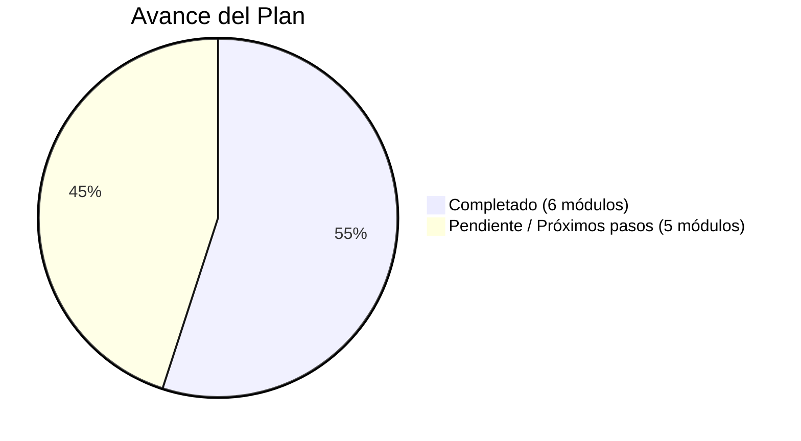

# 🐼 PLAN MAESTRO DE DESARROLLO — PANDASTORE

> **Documento Permanente de Seguimiento**  
> **Archivo:** [`PLAN_PANDASTORE.txt`](file:///c:/Users/Usuario/proyectopandastore20/PLAN_PANDASTORE.txt) y [`PLAN_MAESTRO_PANDASTORE.md`](file:///c:/Users/Usuario/proyectopandastore20/PLAN_MAESTRO_PANDASTORE.md)  
> **Última actualización:** 28 de Septiembre, 2026

---

## 📊 Estado General del Proyecto

---

## 🟢 PARTE 1: Tareas que YA LLEVAMOS (100% Listas y Operativas)

### 1. ✅ Limpieza de Duplicados en Catálogo y Steam
- **Estado:** Completado.
- Se eliminaron productos duplicados en Firestore.
- En el panel de **Admin Juegos Sin Publicar**, ahora se agrupan todas las variantes bajo una **sola ficha canónica** con chips interactivos (`🎮 Juego Base`, `📦 Juego + DLC`, `🧩 Solo DLC`). Cero filas repetidas.

### 2. ✅ Sistema Integral de Revendedores (B2B)
- **Estado:** Completado.
- **Piso de seguridad:** Costo del pack + $5.000 CLP netos garantizados para PandaStore (cero riesgo de pérdidas).
- **Margen dinámico:** Si el precio al público sube (ej. $18.990), la ganancia con el revendedor sube proporcionalmente (+$8.990).
- **Visualización en [`ProductDetail.js`](file:///c:/Users/Usuario/proyectopandastore20/src/pages/Productos/ProductDetail.js):** El revendedor ve su precio mayorista en el selector `(💎 Revendedor)` y el precio principal se resalta en celeste neón tachando el precio público.
- **Carrito y Compra Directa:** Cobran exactamente el monto revendedor acordado.

### 3. ✅ Packs de Nintendo Conectados al Catálogo (Telegram + Firebase)
- **Estado:** Completado.
- Conexión directa con la colección `packs_nintendo` alimentada por el bot de Telegram.
- Si no hay packs disponibles para un juego, su stock pasa a 0 y sale automáticamente como **Agotado**.
- Detección estricta de `[DLC Only]` vs Juego Base vs `+ DLC`.
- Soporte para nombres en Chino, Ruso y Japonés (`我的世界`, `星露谷物语`, `超级马力欧`, etc.).
- En el dashboard se muestra el **Nickname de Telegram** de la cuenta asociada.
- Botón **"🔄 Sincronizar Stock en Tienda"** para actualizar masivamente.

### 4. ✅ Valor del Dólar Fijo y Editable ($900 CLP)
- **Estado:** Completado.
- Centralizado en [`MonedaContext.js`](file:///c:/Users/Usuario/proyectopandastore20/src/context/MonedaContext.js) y ajustable desde el panel de administración.

### 5. ✅ Mejora del CRUD de Productos (Ingreso en CLP -> Conversión Automática)
- **Estado:** Completado.
- Al crear o editar productos en el panel admin, solo se escribe el precio en CLP y el sistema calcula de inmediato el equivalente en USD según la tasa fija.

### 6. ✅ Depuración de Juegos Inviables (Online / Denuvo sin bypass)
- **Estado:** Completado.
- Se retiraron del catálogo los juegos que requieren verificación online permanente o no tienen bypass funcional (ej: NBA 2K25, FC 25, TopSpin 2K25).

### 7. ✅ Limpieza y Reestructuración del Panel de Administrador
- **Estado:** Completado.
- Menú lateral organizado en **5 secciones claras**:
  1. 📊 **Analítica & Métricas** (Tablero Pro, Carritos en vivo)
  2. 🎮 **Catálogo & Productos** (Catálogo web, Switch Bot Packs, Carga Masiva, Armar Pack)
  3. 🔐 **Launcher & Licencias** (Claves Steam PANDA-XXXX)
  4. 💼 **Ventas, B2B & Pagos** (Revendedores, Distribuidores, Métodos de Pago)
  5. 👥 **Clientes & Marketing** (Usuarios, Cupones, Reseñas, Campañas de Email)
- Eliminados módulos obsoletos del menú: *Soporte y Reclamos* y *Preguntas de Productos*.
- Rediseñada la barra del **Dólar Web Fijo** con estilo Ultra Premium Glassmorphism, resplandor esmeralda, presets de 1 clic ($850, $900, $920, $950, $1.000) y soporte móvil.

---

## 🟡 PARTE 2: Tareas que FALTAN (Próximos Pasos Prioritarios)

### 8. ⏳ Integración de Binance Pay en las 4 Pantallas de Pago
* **Objetivo:** Automatizar la recaudación en criptomonedas (USDT/BUSD) mediante la API oficial de Binance Pay.
* **Pantallas a integrar:**
  1. [`CheckoutCarrito.js`](file:///c:/Users/Usuario/proyectopandastore20/src/pages/Checkout/CheckoutCarrito.js)
  2. [`CheckoutCompraDirecta.js`](file:///c:/Users/Usuario/proyectopandastore20/src/pages/Checkout/CheckoutCompraDirecta.js)
  3. Modal / pantalla de compra rápida de DLCs.
  4. Recarga de saldo en Perfil / Custom Packs.
* **Flujo:** Generar orden de pago cripto con QR y webhook para entrega inmediata de la licencia.

### 9. ⏳ Rediseño y Mejora Visual de Licencias
* **Objetivo:** Experiencia de cliente premium al recibir sus claves.
* **Acciones:**
  * Rediseñar la tarjeta de licencia en [`MisPedidos.js`](file:///c:/Users/Usuario/proyectopandastore20/src/pages/Checkout/MisPedidos.js) con estilo VIP neón y botón de copiado rápido.
  * Acceso directo en 1 clic a la descarga del Launcher con tutorial guiado.
  * Mejorar la vista de gestión en [`AdminLicencias.js`](file:///c:/Users/Usuario/proyectopandastore20/src/pages/Admin/AdminLicencias.js).

### 10. ⏳ Mejoras del Launcher PandaStore (C# / WPF)
* **Objetivo:** Vincular la tienda directamente con el Launcher de escritorio.
* **Acciones:**
  * **Fusión Tienda + Launcher para DLCs:** Si el cliente tiene el juego base instalado y no tiene los DLCs, ofrecerle comprarlos directamente. Al pagar con Mercado Pago / Binance Pay (o WhatsApp), se habilitan al instante en su licencia.
  * **Perfil y Estadísticas en el Launcher:** Pestaña con fecha de compra, juegos en biblioteca, horas de juego y recompensas o regalos por fidelidad según el volumen de compras.

### 11. ⏳ Preguntas Frecuentes (FAQ) y Ajustes Móviles
* **Objetivo:** Reducir consultas repetitivas al soporte.
* **Acciones:**
  * Actualizar la sección de Preguntas Frecuentes con guías claras para Launcher, llaves Steam, cuentas Nintendo Switch y compras de revendedor.
  * Ajustes finales de diseño responsive en dispositivos móviles.

---

*Archivo de texto plano guardado permanentemente en:* [`c:\Users\Usuario\proyectopandastore20\PLAN_PANDASTORE.txt`](file:///c:/Users/Usuario/proyectopandastore20/PLAN_PANDASTORE.txt)
